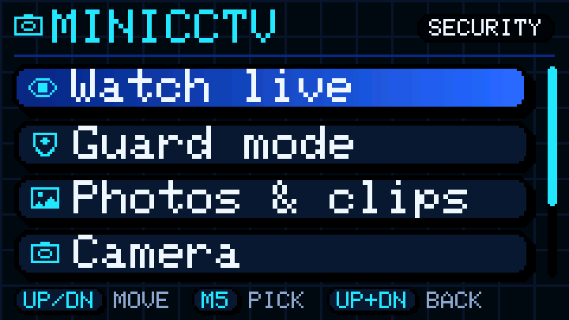
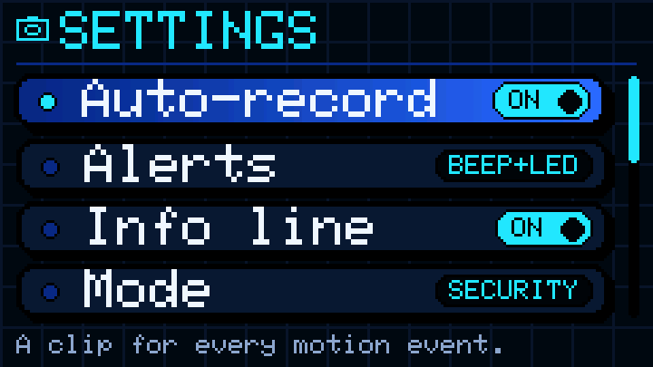
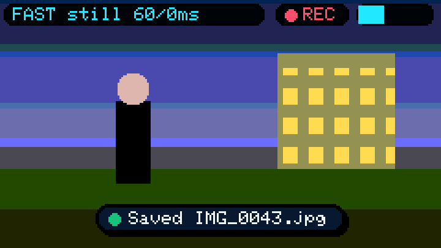
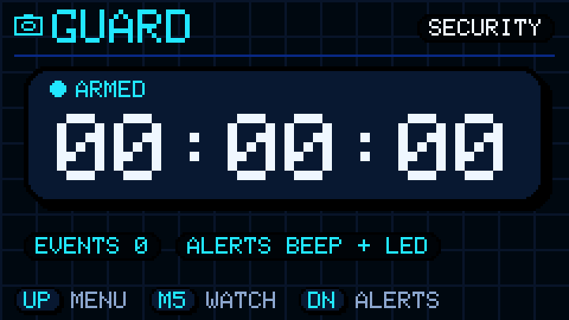
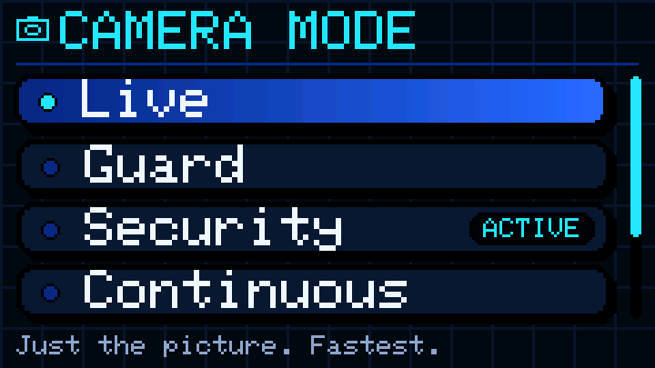
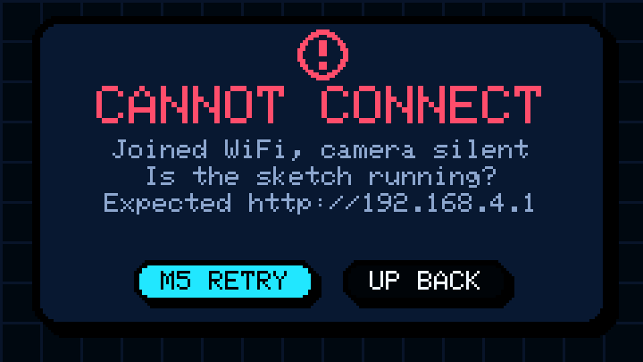

# mini-cctv

An **ESP32-S3 camera board** (built for the OceanLabz ESP32-S3-WROOM N16R8 CAM) that streams to, and is controlled from, a **JS app running inside Bruce** on an **M5StickC Plus2**. It is a small security camera: live view, zoom and pan, filters, photos, video clips, DVR rewind, motion alerts, and a security mode that keeps working when the Stick isn't around.

```
 ESP32-S3 CAM (OceanLabz)                                 M5StickC Plus2 (Bruce, full build)
┌─────────────────────────────┐   WiFi (S3 is the AP)    ┌────────────────────────────────────┐
│ sensor 640x480              │                          │ bruce/MiniCCTV.js                  │
│  ├ motion detection         │   GET /d?f=j&s=<seen>    │  menu, guard mode, gallery,        │
│  ├ recording rules + SD     │ ◀─────────────────────── │  camera settings                   │
│  ├ photo / clip / timelapse │ ── changed bands only ─▶ │  display.drawJpg / drawBitmap      │
│  ├ DVR history (PSRAM)      │   GET /ctl?..  /m?..     │  buzzer + red LED + IR on motion   │
│  └ pan/zoom → 240x135 bands │                          │                                    │
└─────────────────────────────┘                          └────────────────────────────────────┘
        keeps working on its own: motion → photo + clip on the SD card
```

## Why not USB OTG?

The Stick Plus2 is built around a plain ESP32 (ESP32-PICO-V3-02). That chip has no USB peripheral at all, so it can't be a USB host or device. Its USB-C port goes to a CH9102 USB-to-serial chip, used for charging and flashing. Bruce's JS `serial` module only talks to that port, and has no API for the Grove pins. That leaves **WiFi**, and Bruce's JS has what it needs: `wifi.httpFetch(..., {responseType:'binary'})` and `display.drawJpg` / `display.drawBitmap`.

## Camera modes

The mode lives **on the camera** and is saved to flash, so a security service keeps running while the Stick is away and survives a power cut. Change it from the Stick (Settings → Mode) or from any browser: `http://192.168.4.1/ctl?mode=2`.

| Mode | What runs | Needs an SD card |
|---|---|---|
| **Live** | just the picture. Nothing else, so it is the fastest | no |
| **Guard** | live + motion detection + DVR rewind. The Stick can alert you. Stores nothing | no |
| **Security** | the full service: motion alerts, DVR rewind, **a photo when motion starts and a video clip for every event** | yes |
| **Continuous** | records video all the time (clips back to back, oldest deleted when the card is full), plus alerts and rewind | yes |
| **Timelapse** | a photo every N seconds (10 s to 1 hour) | yes |

Photos and clips can always be started by hand from the Stick, in any mode. The first time the camera boots it is in **Security**; change `DEFAULT_MODE` in `config.h`.

**No SD card?** The camera and the Stick say so (a notice when you connect, a `NO SD` tag on the picture, and a warning on the camera's serial output), and everything that doesn't need storage keeps working: live view, zoom, filters, motion alerts, rewind. Put a FAT32 card in at any time and the camera picks it up within 30 seconds.

## On the Stick

Run **JS Interpreter → MiniCCTV.js**. The Stick has two side buttons and the front M5 button. Bruce calls them **UP** (Prev), **DOWN** (Next) and **M5** (Sel).

The screens follow the **Knowura design language**: dark ground with the faint grid, black ink outlines, hard offset shadows (never blurred), cyan for icons and active things, the deep-blue → blue gradient on the selected row, uppercase labels in the Stick's pixel font, key caps for the buttons, and red or green only for problems and results (always with a word or icon).

| | |
|---|---|
|  |  |
|  |  |
|  |  |

*These are renders of the real app (`tools/ui_preview.js`) with a made-up picture, not photos of a Stick; the panel's own colours will differ a little.*

### Main menu

| Item | |
|---|---|
| **Watch live** | the picture |
| **Guard mode** | the screen goes (nearly) dark and the Stick listens for motion. On motion it wakes, alerts, shows what's happening, and goes dark again 15 s after things settle |
| **Photos & clips** | browse what's on the camera's SD card and view it on the Stick |
| **Camera** | filter, night, flip, brightness, zoom/pan: the things you adjust while looking at the picture |
| **Settings** | what the app and the camera start with (below) |
| **Exit** | |

While the main menu is open and the Stick is on the camera's WiFi, it still watches for motion (MOTION! screen + alert), so you don't have to be in Guard mode.

### Settings

Main menu → **Settings**. Changes apply straight away and are remembered.

| Row | Choices | Stored |
|---|---|---|
| **Auto-record** | On / Off: record a clip for every motion event (it applies in Security mode) | on the camera |
| **Picture** | **Fast** or **Photo**: the view the live picture starts in. Photo = 16-bit colour, moving areas blink briefly. Fast = 8-bit dithered, never blinks | on the Stick |
| **Alerts** | Off / LED / Beep+LED: what the Stick does on motion | on the Stick |
| **Info line** | On / Off: fps and timings on the live picture | on the Stick |
| **Mode** | Live, Guard, Security, Continuous, Timelapse | on the camera |
| **Timelapse** | 10 s, 30 s, 1 m, 5 m, 15 m, 1 h | on the camera |

The Stick's choices live in `/MiniCCTV.cfg` on its internal storage (a small JSON file; a damaged or out-of-range file is ignored and the defaults are used). The actions menu in the live viewer can still flip Picture, Info line and Mode on the spot; those are for the current session, only Settings changes the defaults. The camera rows show `...` until the app has talked to the camera once; selecting one connects first. The Stick-side rows work with the camera off.

### Buttons

| | UP | DOWN | M5 |
|---|---|---|---|
| Menus | move up | move down | select |
| Live viewer | back to the menu | **take a photo** | **actions menu** |
| Zoom/pan screen | change the selected value (zoom in / left / up) | change the other way | next control (Zoom, Pan, Pan, Reset, Done) |
| Rewind | older, 5 s | newer, 5 s (past live = back to live) | menu: play/pause, back to live |
| Photo / clip playback | back | skip 10 s | menu: play/pause, ±10 s |
| | **UP + DOWN together: back out of a menu; in the viewer or main menu, quit the app** | | |

The **actions menu** (M5 in the live viewer): Resume, Photo, Record clip / Stop recording, Zoom / Pan, Rewind (DVR), Filter, Night, Mode, Picture, Info, Main menu.

The **info line** at the top of the picture shows the picture mode, updates per second (`still` when nothing changes) and milliseconds spent on the network and drawing (`net/draw`). The right edge has a motion meter (cyan; red when the moving area is person-sized), a red `REC` while recording, and a red `NO SD` when there's no card. Errors show in red in the info chip.

### Alerts

On motion the Stick can use: the **buzzer** (one beep; three rising beeps for a person-sized mover), the **red LED on G19** (it shares the pin with the IR emitter), a flash of the screen in Guard mode, and an **IR command**: set `IR_FILE = '/BruceIR/lamp_on.ir'` at the top of `MiniCCTV.js` to send a saved Bruce IR file (switch a lamp on). IR is sent at most once a minute (`IR_GAP_MS`).

"Person-sized" is a **size heuristic**, not recognition: the moving area has to be a few percent of the scene. It tells a person from a cat or an insect, not a person from a large dog.

### Zoom, filters, night

The sensor captures 640x480 and the Stick shows 240x135, so **zoom is real detail**, not enlarged pixels, up to about 2.6x (it goes to 4x, but beyond 2.6x it only upscales). Filters run on the camera: **Night** (auto-levels + gamma + green tint), **Grey**, **Thermal** (false colour) and **Edge**. **Night mode** raises the sensor's gain and exposure.

### Photos, clips and the DVR

- **Photos** are the full 640x480 sensor picture, JPEG, saved as `/cctv/photos/IMG_0001.jpg`.
- **Clips** are MJPEG AVI, 320x240 at 8 fps, `/cctv/clips/VID_0001.avi`. They play in VLC, a phone or Windows. A security clip ends 8 s after the last motion and is cut at 2 minutes (5 minutes in Continuous). When the card has less than 150 MB free the oldest clips are deleted first.
- From a phone on the camera's WiFi: `http://192.168.4.1/gallery` lists and downloads everything; the home page `http://192.168.4.1/` shows live video with *take photo* and *record* links.
- **Rewind** needs Guard, Security or Continuous mode. The camera keeps about 3 MB of recent pictures (a few frames a second while something moves, one every 2 s when still), so minutes of history fit. Rewind shows what the camera saw, with your current filter applied.

## Setup

### 1. Flash the camera (Arduino IDE)

Open `firmware/mini_cctv/mini_cctv.ino` (the other files in that folder go with it). No extra libraries: the camera driver and SD support ship with the ESP32 board package.

| Tools menu (OceanLabz ESP32-S3-WROOM N16R8 CAM) | Setting |
|---|---|
| Board | **ESP32S3 Dev Module** |
| **PSRAM** | **OPI PSRAM** (required: the sketch stops at boot without it) |
| Flash Size | 16MB (128Mb) |
| Partition Scheme | "16M Flash (3MB APP/9.9MB FATFS)" or any scheme with an app of 2 MB or more |
| USB CDC On Boot | Enabled if you use the board's native-USB port for the Serial Monitor |

PlatformIO: `cd firmware && pio run -e oceanlabz -t upload` (other envs: `s3cam`, `s3cam_qspi`, `s3cam_lcd`, `xiao_s3`).

Camera pins default to the ESP32-S3-EYE map (`CAMERA_MODEL_ESP32S3_EYE`, top of the sketch), which your board reported working. WiFi: the camera starts a network **`ESP32-CAM-S3`**, password `12345678` (change both in `config.h`, and in `MiniCCTV.js`).

### 2. The SD card

Use a **FAT32** card (32 GB or smaller is simplest). The sketch uses the board's SD slot in 1-bit SD_MMC mode on pins **CLK 39, CMD 38, D0 40**, the wiring the Freenove ESP32-S3-WROOM CAM documents and the ESP32-S3-EYE uses. **The vendor doesn't publish the OceanLabz SD pins**, so if the Serial Monitor (115200) says `SD: init failed ... CLK=39 CMD=38 D0=40`, check the pins against the board's schematic and set `SD_CLK_PIN`, `SD_CMD_PIN`, `SD_D0_PIN` in `config.h`. A healthy boot prints `SD: ok, 29.7 GB card, 29500 MB free`. SD cards wired over SPI (the XIAO ESP32S3 Sense, for example) are not supported.

### 3. Put the app on the Stick

Copy `bruce/MiniCCTV.js` to `/BruceJS/` on the Stick's SD card, or upload it through the Bruce WebUI. It joins the camera's WiFi itself. The config block at the top must agree with `config.h` (SSID, password, `OUT_W`/`OUT_H`); if it doesn't, the app says so instead of drawing garbage. It needs a Bruce with the mquickjs interpreter (`drawJpg`/`drawBitmap` taking a `Uint8Array`, `httpFetch` with `responseType: 'binary'`).

**Memory:** the app needs about 84 KB of the interpreter's heap when loaded (the pixel icons, the UI toolkit) and about 136 KB at peak while streaming. Bruce gives the interpreter about 250 KB on a Stick with PSRAM (every Stick Plus2) but only about 64 KB without, where it would not fit.

### Using your router instead

Set `USE_STA 1` and your SSID and password in `config.h`. Read the IP from the serial monitor. In `MiniCCTV.js` set `CAM_HOST` to `http://<that ip>` and `JOIN_CAM_WIFI = false`, and connect the Stick to the same network from Bruce's WiFi menu.

## Tuning (`firmware/mini_cctv/config.h`)

| Setting | Effect |
|---|---|
| `DEFAULT_MODE`, `TIMELAPSE_SEC` | the mode on the very first boot, and the timelapse interval |
| `CAM_FRAMESIZE` | `FRAMESIZE_VGA` (default, sharper) or `FRAMESIZE_QVGA` (faster, softer) |
| `STRIP_JPEG_QUALITY` | Photo mode quality |
| `DELTA_PIX_THRESH`, `DELTA_PIX_COUNT`, `DELTA_MEAN_THRESH` | how much a band must change before it's resent (raise if a still scene keeps updating) |
| `MOTION_LUMA_THRESH`, `MOTION_MIN_CELLS`, `MOTION_BIG_TENTHS`, `MOTION_GLOBAL_PCT`, `MOTION_HOLD_MS` | motion sensitivity, the "person-sized" threshold, ignoring lights switching on, how long motion stays active |
| `REC_*`, `PHOTO_JPEG_QUALITY`, `SD_MIN_FREE_MB` | clip size, frame rate, quality, lengths, and when old clips are deleted |
| `HIST_BYTES`, `HIST_*` | how much DVR history to keep |

## How it works

- **Bands.** The 240x135 picture is cut into nine bands of 16 rows (the JPEG block height). Each time the picture changes the camera numbers the update (`seq`) and remembers, per band, when it last changed. The Stick asks "what changed since update N?" (`/d?f=j&s=N`) and gets only those bands plus the new `seq`. A lost reply is repaired by asking again; a camera that reboots counts from 1 again, which the Stick notices. The format is in `firmware/mini_cctv/delta.h`; every reply's header also carries the motion level and flags (recording, SD present, person-sized, motion active, replay).
- **Long-polling.** If nothing has changed the camera holds the request open for up to 150 ms, so a quiet scene costs almost no traffic and changes show up as they happen.
- **Why bands.** Bruce's `drawJpg` clears the area it paints before decoding into it, so a full-frame JPEG flashes the whole screen. Bands that only touch what moved keep the flash local (Photo) or remove it (Fast, 8-bit `drawBitmap`, which paints in place). Note that Bruce's `drawBitmap` at 16 bits would be drawn as a 1-bit bitmap on the Stick's display library, and a `subarray` view passed to a draw call is drawn from the start of its buffer, so the app copies each band into its own array first.
- **A view override** replaces the live picture with a rewound frame, a photo or a clip. Because it goes through the same band pipeline, the Stick needs no special code to show them.
- **Motion** is measured on an 80x60 brightness grid of the whole sensor picture against a slowly adapting background, independent of zoom and filters. Most of the picture changing at once (lights, auto-exposure) is ignored.
- **Recording** runs on its own writer task fed through a small pool of buffers, so a slow SD card can never stall the camera or the Stick; if the card falls behind, video frames are dropped, not the live picture.
- **The camera decodes JPEGs** for rewind, photos and clips with the camera driver's decoder. Its colour byte order differs between driver versions, so at boot the camera decodes a known pure-red picture to learn the layout.

## Testing without hardware

```bash
tools/run_tests.sh
```

Needs g++, Python 3 with Pillow, and Node; ffmpeg and git/gcc/make are used if present. It runs:

- **C++ tests under AddressSanitizer** (`tools/test_scaler.cpp`, `test_features.cpp`, `test_delta.cpp`, `test_avi.cpp`): scaling, dithering, change detection, zoom/pan, filters, motion detection, the DVR ring buffer, recording rules, the mode table, the band protocol and the AVI writer/reader. `ffprobe` and `ffmpeg` then independently check that a written clip is a valid MJPEG file that decodes and seeks.
- **The Bruce app on two engines**: Node, and the **real mquickjs engine Bruce runs** (`tools/get_mqjs.sh` builds it from `BruceDevices/mquickjs`). 24 scripted scenarios drive the real menus with button presses against a fake camera (`tools/mq/fakecam.js`), with mocks that follow what Bruce's firmware really does. They cover every feature above, no SD card, connection and mid-stream failures, a rebooting camera, and replies produced by the real C++ encoder. The mode and filter tables are checked against the firmware's own. Settings get their own scenarios: auto-record, defaults saved and reloaded, damaged or out-of-range files, storage that throws, and the camera being off.
- `node tools/mutate.js <golden_dir>` breaks the app 32 different ways, one at a time, and checks that the suite notices each (it does: 32 of 32). A mutant that survives would mean a test that proves nothing.
- `node tools/ui_preview.js` renders the screens above to `docs/screens/` by running the real app against a software model of Bruce's display (the same 5x7 font and round-rect maths as TFT_eSPI). It also counts anything drawn off-screen.
- `node tools/mq_footprint.js <mqjs>` measures the app's JS heap use on that engine.
- `node tools/fake_cam_server.js` serves the fake camera over HTTP so a real Stick can be tried against a laptop (set `CAM_HOST` to the laptop and `JOIN_CAM_WIFI = false`).

## Uploading with Claude Code

`.claude/agents/uploader.md` is a Claude Code subagent that uploads the project for you. In a Claude Code session on this repo say "upload it" (branch only) or "upload it to main" (also fast-forwards `main`), or call it with `@agent-uploader`. It commits what is pending (leaving out build output and anything that looks like a secret), runs `tools/run_tests.sh` and, if the firmware changed, builds all five environments, then pushes. If a test or build fails it stops and tells you instead of pushing. It never force-pushes, never opens a pull request unless you ask, and refuses to move `main` unless it is a clean fast-forward.

To flash, run `/flash` in Claude Code on your own computer (`.claude/commands/flash.md`): it pulls `main`, flashes the camera with PlatformIO (or `arduino-cli`), reads the boot log back to you, and copies the app to the Stick.

The uploader can't flash anything: it runs in the cloud with no access to your USB ports. Its report ends by saying which of the two you need to redo on your computer: re-flash `firmware/mini_cctv/` from the Arduino IDE, and/or copy `bruce/MiniCCTV.js` to `/BruceJS/` on the Stick.

## Status

- **Verified here:** the logic of everything above (C++ under AddressSanitizer; AVI files by ffprobe/ffmpeg), the app on the real mquickjs engine including its memory use, the Bruce API behaviour it relies on (read from `pr3y/Bruce` at `a59213f` and its mquickjs fork), and that the firmware compiles on Arduino-ESP32 core 2.0.17 for all five envs.
- **Not verified, because it needs the hardware:**
  - the camera running this version, and its real frame rate (the Serial Monitor prints `fps`, `loop` and `wait` times, and `/status` shows them);
  - the SD card: the pin map for your board (see above), and write speed during recording;
  - JPEG decoding for rewind, photos and clips (`/status` shows `"dec": 0..3` when the decoder layout was recognised; `-1` means those three features are disabled);
  - the Stick app on a real Stick (the mocks are faithful but they aren't a Stick), and the buzzer/LED/IR calls;
  - a build on Arduino-ESP32 core 3.x (my sandbox couldn't download it).
- **Limits:** "person-sized" is a size heuristic; there is no real person recognition (the on-device ML libraries aren't available in the Arduino IDE core). One camera, one Stick (two Sticks would see the same picture and fight over zoom). The Stick needs a Bruce build with the mquickjs interpreter and PSRAM.
